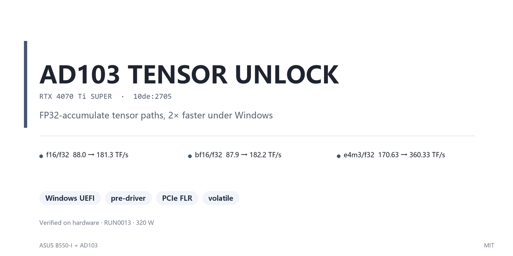

# RTX 4070 Ti SUPER (AD103, `10de:2705`) — Windows UEFI tensor unlock

把上游 [`JustAResearcher/gpu-unlock-ada`](https://github.com/JustAResearcher/gpu-unlock-ada) 的
MSI AD104 Windows UEFI 端口移植到一张 **ASUS B550-I + AD103 4070 Ti SUPER**，在 NVIDIA 驱动
绑定之前改掉 SM 的权限位，拿到 FP32-累加 tensor 路径的 2× 算力。

**已验证成功。** 最后一次是 `RUN0013`（2026-10-28 07:43）：320 W VBIOS override 生效的同时
解锁完成，`f16/f32 ÷ f16/f16 = 1.002`。断电即失效，每次开机走一遍 U 盘。

## 结果

`mma_bench`，register-resident 指令发射率，20000 iter，66 SM，sm_89。

| 模式 | stock | 解锁 285 W | 解锁 320 W | 倍数 | 是否目标 |
|---|---:|---:|---:|---:|---|
| `f16/f32` (FP16 in, FP32 acc) | 88.0 | 176.1 | **181.3** | **2.06×** | ✅ |
| `bf16/f32` (BF16 in, FP32 acc) | 87.9 | 175.6 | **182.2** | **2.07×** | ✅ |
| `e4m3/f32` (FP8 in, FP32 acc) ※ | 170.63 | 319.58 | **360.33** | **1.87–2.19×** | ✅ |
| `f16/f16` (FP16 acc) | 175.6 | 175.1 | 180.9 | 1.00× | 控制组 |
| `s8/s32` (INT8) | 352.5 | 348.0 | 367.8 | 0.99× | 控制组 |
| `dp4a` | 87.0 | 87.7 | 89.8 | 1.01× | 控制组 |
| `ffma` (scalar FP32) | 41.8 | 41.5 | 41.7 | 0.99× | 控制组 |

※ 这一行是 `mma.m16n8k32.e4m3.e4m3.f32` 的**指令发射率，不是 GEMM**，和其余六行不是同一个
仪器。上游在真 GEMM 上量到 FP8 只有 0.3%。两件事不矛盾，理由见 [docs/EVIDENCE.md](docs/EVIDENCE.md)。

单位 TF/s。控制组三行不动，说明改的只是 FP32-累加那条路径。

**判据只用比值，不用绝对值：`f16/f32 ÷ f16/f16`，stock ≈ 0.50、解锁 = 1.00。**
绝对值会随 SM 频率整体漂 6%，降频狠了 `f16/f32` 能落到 88，和没解锁的样子一样。

数值校验 `gemm_check` 六组共 **159870 个 cell**，全部 `failures=0 max_abs=0`。

原始输出在 [results/](results/)，仪器条件与全量数字在 [docs/EVIDENCE.md](docs/EVIDENCE.md)。

## DLSS 和帧生成：没有收益

| 路径 | 用什么硬件 | 受这次解锁影响吗 |
|---|---|---|
| 帧生成 (Frame Generation) | Optical Flow Accelerator，独立单元 | **否** |
| DLSS 超分 | tensor core `HMMA.16816.F16`（FP16 累加） | **否** |
| 本次解锁 | `HMMA.16816.F32` / `BF16.F32` / `FP8.F32`（FP32 累加） | 是 |

3DMark 实测 `+0.09%` / `+0.21%`，都在噪声内。`f16/f16` 解锁前后都是 175–188，已是 sm_89 的
FP16 tensor 峰值，DLSS 超分走的就是那条；帧生成根本不碰 tensor core。

会变快的只有 FP32 累加的 tensor 路径。完整证据与「想自己测帧率」的四步见
[docs/DLSS.md](docs/DLSS.md)。

## 方法

三步，全部在开机的 UEFI 阶段完成，早于 NVIDIA 驱动绑定：

1. 读显卡 VBIOS，解析 FWSEC 描述符，释放 WPR2
2. 从 GSP Falcon 里以 heavy-secure 模式拉起 FWSEC，再走 SEC2 Booter
3. 写 `FEAT_OVR_PLM=0xffffffff`、`SS0=0x88888888`、`SS1=0x8`，然后对 GPU 做一次 PCIe FLR，
   验证三个值在 FLR 后仍然保持

驱动随后加载时看到的是「权限已全开」的硬件状态。改动的寄存器原文见
[docs/EVIDENCE.md](docs/EVIDENCE.md)。

## 开工顺序

1. **确认硬件对得上。** 见下面「硬件」一节。不同型号要重跑移植工具，见
   [docs/REPRODUCE.md](docs/REPRODUCE.md)。
2. **取分支。** `git fetch https://github.com/A-XIANGQAQ/gpu-unlock-ada ad103-2705`，
   checkout 到 `windows\ad103-2705`。分支里已经是本卡的移植结果。
3. **填本机标识。** 照 `boot_profile.example.h` 建 `local\boot_profile.h`
   （本卡：614400 sectors + 自己的 GPT partition GUID）。这个文件故意不提交。
4. **编译。** `.\Build-Experimental.ps1` → `build\AD104-EXPERIMENTAL.EFI`。哈希可复现，
   `rebuild-efi.ps1` 就是靠这一点。
5. **部署到 FAT32 U 盘。** `tools\deploy-usb.ps1 -Drive H -Profile unlock -efi <上面的产物>`。
   它不格式化、不分区、不碰内置 ESP。
6. **开机 F8 选 U 盘，按 `U`。** 约 40 秒进 Windows，然后可以拔掉 U 盘。

完整命令、每个脚本的边界、换卡流程、从任意提交重建，都在
[docs/REPRODUCE.md](docs/REPRODUCE.md)。

## 易失性

`SS0` / `SS1` 是 volatile 寄存器。**完全断电后 `SS1` 回到 `0x1`、`SS0` 回到某个新的随机值**，
需要重新走一遍开机流程。普通重启（不断电）不清。

本仓库只采用 **U 盘手动引导**：插 U 盘 → F8 → 选 U 盘 → 按 `U` → 约 40 秒 → 进 Windows。

接管 ESP 的 `bootmgfw.efi` 或改 BCD 都能省掉按键，代价是把实验代码放进启动关键路径。这条在
这台机器上装上去就进不了系统，`install-esp.ps1` 保留但不用，详见
[docs/INCIDENT-esp-takeover.md](docs/INCIDENT-esp-takeover.md)。

「断电后回到 stock」别拿 `SS0` 的等号去验；它每次冷启动都不同。看 `SS1==0x1` 加 `readout1`
的 `full=0` 就够了。实测见 [docs/EVIDENCE.md](docs/EVIDENCE.md)。

## 硬件

| 项 | 值 |
|---|---|
| GPU | NVIDIA RTX 4070 Ti SUPER，AD103，`10de:2705`，16376 MiB，66 SM |
| VBIOS | `95.03.45.40.c5` |
| 驱动 | 621.01 |
| 主板 | ASUS ROG STRIX B550-I GAMING，BIOS 4304 |
| CPU | AMD Ryzen 7 5700X3D（无核显） |
| OS | Windows 11 专业工作站版 `10.0.26300` Build 26300，Secure Boot 关闭 |
| PCI | `0000:08:00.0`，BAR0 `0xFB000000` (16 MiB)，BAR1 16 GiB（Re-BAR 开） |
| 功耗 / 频率 | 出厂 285 W。后来给功率表挂了一份 320 W 的 VBIOS override（[PITFALLS #13](docs/PITFALLS.md)），`RUN0013` 起跑在 320 W。`clocks.max.sm` 3165 MHz，PCIe Gen4 ×16 |

## 仓库结构

```
windows/ad103-2705/   本卡的移植（在 fork 分支上，不在这里）
bench/                四个探针 + build.cmd，见 bench/README.md
tools/                六个脚本，见 tools/README.md
results/              原始 benchmark 输出 + SHA256SUMS，见 results/README.md
docs/                 九篇文档，见 docs/README.md
```

`bench/*.cu`、`bench/build*.cmd`、`tools/` 下除一个文件外都是自己写的 MIT，首行带 SPDX。
例外是 `tools/gen_profile.py`，它内嵌上游 `profile.c` 的函数体，按 GPL-2.0 算衍生作品，
标的是 `GPL-2.0-only`。

`results/` 里有两份故意留着的异常样本：`cublas-contaminated.txt`（后台有游戏占 GPU，峰值
仍是 180 但后续 rep 塌到 2.0）和旧 cuBLAS 采样里 `fp16/fp16acc` 4588 那条（alpha 宽度
bug，每个 GEMM 输出全零矩阵）。两条都记在 [docs/PITFALLS.md](docs/PITFALLS.md)。

## 状态

三次真正解锁过这块卡：`RUN0005`（无 override，285 W）、`RUN0006`（v1 override）、
`RUN0013`（320 W override 生效）。

两条路都能走，但只有一条能同时拿到 320 W：

| 要哪个 | 用哪个 EFI | 注册表 override | 功率 |
|---|---|---|---|
| 只要解锁 | `76FEE036` | 必须卸掉 | 285 W |
| 解锁 + 320 W | `07052565` 及以后 | 保留 | 320 W |

`76FEE036` **没有** blank 入口态这道闸门（二进制里搜不到 `blank selectors`，`wantSS1=` 还在），
挂着 override 开机它读到 `SS0=0 SS1=0` 就会拒，和 `RUN0007` 到 `RUN0012` 那六次一样。
`07052565` 同时接受 stock `SS1==1` 与 blank 两种入口态，但这一版在**没挂 override** 的机器上
还没上过机。

**没做的**：ESP 接管那条仍未验证通过，唯一存活线索是 `boot_io.c` 的 `Inspect()` 会拒绝第二个
`MEDIA_HARDDRIVE_DP` 节点（已改，但从未在 ESP 路径上重测）。

五个测试套件都在这个端口上跑得起来，全部返回 0。这些测试以前一条都跑不了，因为夹具里写的是
上游那张 AD104 卡的常量（device id `0x2782`、bus 1、3086728 字节的 bootmgr）：

| 套件 | 规模 |
|---|---|
| `test_app_flow` | 313 checks / 17 scenarios |
| `test_guards` | 17 admission cases |
| `test_efi_transaction` | 120 scenarios（30 × 4 permutation） |
| `test_boot_io` | 718 checks / 18 cases |
| `test_msi_release` | 763156 checks / 47 cases（跑的是 `synthetic` 替身） |

判读日志用 [`tools\classify-run.ps1`](tools/classify-run.ps1)，它把一份 `RUN*.TXT` 分成十七种
结局，`-All` 把历史每一轮压成一行。每次构建的哈希与上机记录在
[docs/WHERE-IT-STOPPED.md](docs/WHERE-IT-STOPPED.md)。

移植期撞到 19 个坑，每条都是「症状 → 原因 → 改法」：[docs/PITFALLS.md](docs/PITFALLS.md)。
其中 cuBLAS alpha 宽度、`Sealed` 不复位、为绕过 `GpuChild()` 而放宽的图检查、`profile.c`
是生成文件、以及工作区里启动的进程写不了工作区外的临时目录，这几条最贵。

## License

MIT，见 [LICENSE](LICENSE)。例外：`tools/gen_profile.py` 是 `GPL-2.0-only`。

## 致谢

- [`JustAResearcher/gpu-unlock-ada`](https://github.com/JustAResearcher/gpu-unlock-ada)：
  本移植的上游，MSI AD104 Windows UEFI 端口的原作者
- [`impacifist/Windows-GPU-UNLOCK`](https://github.com/impacifist/Windows-GPU-UNLOCK)：
  上游的 snapshot/delta 策略来源。它在本移植做不到的两点上更成熟：多个显示子节点的显式枚举
  （v0.3.1 处理到 4 个），以及没有第二显示 GPU 时的 `GU_CONSOLE_AGGREGATE` 拓扑。差距记在
  [docs/PRIOR-ART.md](docs/PRIOR-ART.md)
- [`unitypit71/rtx4070tisuper-tensor-unlock`](https://github.com/unitypit71/rtx4070tisuper-tensor-unlock)：
  同型号的 Linux 侧完整案例，FWSEC/SEC2 流程的交叉参考
- [`Zagitta/gpu-unlock`](https://github.com/Zagitta/gpu-unlock)：机制的最初实现
